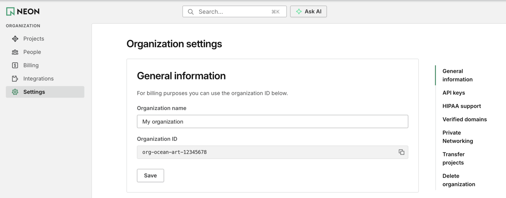

# Get Neon credits

The workshop uses the Neon AI Gateway. We'll add credits to your Neon organization, and you just send us its ID.

1. **Create a free Neon account** at [console.neon.tech/signup](https://console.neon.tech/signup). Sign-up asks a few onboarding questions; skip them or pick anything. Your answers don't matter.

2. **Open your organization settings.** In the left sidebar, under **ORGANIZATION**, click **Settings**. Don't use the menu under your name at the top right; that's your account settings, not the organization's.

3. **Copy your organization ID.** Under **General information**, copy the **Organization ID**. It looks like `org-ocean-art-12345678`.

   

4. **Submit the form:** [Neon credits form](https://forms.gle/jDcUNgj1d14tNGbg9). Enter your email and the organization ID.

You don't need to create a project or database for this. We'll add the credits to that organization.
