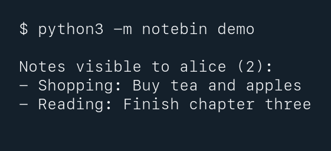

# Notebin

Notebin lists each user's notes. It uses sample data in an in-memory SQLite database.

From the repository root, run with Python 3:
```sh
python3 -m notebin demo
```

Run the tests:
```sh
python3 -m unittest discover -s notebin/tests -v
```


